# miro-atlassian-skills

<p align="center">
  
</p>

## What this repo is

Five [Agent Skills](https://agentskills.io) for drawing on Miro and publishing to Confluence. Install them into Cursor, Claude Code, Claude.ai, or any other agent the [skills CLI](https://skills.sh) supports. Sign in to the Miro and Atlassian connectors, then ask in chat.

One Confluence page, the workspace map, indexes your pages and Miro frames by id. The diagram skills draw a use case, a sequence, or a data-flow diagram as a frame on a Miro board. The publish skill puts that frame on a Confluence page as a PNG and a short description. A later chat reads the map and opens the page or frame by id.

That index is what keeps later chats cheap. The agent opens a known id instead of searching the space or the board, and a matching local cache is a version check, not another full page read. Each skill names the tool to call and loads a long procedure only at the step that needs it, so the prompt stays small. A frame is read once, Miro's authoring guide is loaded once per chat, and the Confluence write is a small edit of the diagram section instead of the whole page. Fewer connector calls and fewer tokens on every diagram after the first.

## Install

Node.js 20 or newer. The command installs all five skills and asks which agents to use.

```bash
npx skills add HuzaifaTanzeel/miro-atlassian-skills
```

Add `-g` to install for every project. Later, update with the same flag you installed with:

```bash
npx skills update -y
```

## Claude.ai

Claude.ai has no `npx`. Download one zip per skill from the [Claude skill zips](https://github.com/HuzaifaTanzeel/miro-atlassian-skills/releases/latest) release and upload it. Each zip contains `<skill-name>/SKILL.md`.

| Skill | Download |
|---|---|
| Workspace map | [workspace-map.zip](https://github.com/HuzaifaTanzeel/miro-atlassian-skills/releases/latest/download/workspace-map.zip) |
| Use case diagram | [miro-use-case-diagram.zip](https://github.com/HuzaifaTanzeel/miro-atlassian-skills/releases/latest/download/miro-use-case-diagram.zip) |
| Sequence diagram | [miro-sequence-diagram.zip](https://github.com/HuzaifaTanzeel/miro-atlassian-skills/releases/latest/download/miro-sequence-diagram.zip) |
| Data flow diagram | [miro-data-flow-diagram.zip](https://github.com/HuzaifaTanzeel/miro-atlassian-skills/releases/latest/download/miro-data-flow-diagram.zip) |
| Publish to Confluence | [miro-to-confluence.zip](https://github.com/HuzaifaTanzeel/miro-atlassian-skills/releases/latest/download/miro-to-confluence.zip) |

Customize → Skills → **+** → **Create skill** → **Upload a skill**. Turn on **Code execution and file creation** under Settings → Capabilities first. On Team and Enterprise, an owner enables that under Organization settings → Plugins & skills. When a newer release is published, upload the zip again.

## Connect Miro and Atlassian

Sign in in the browser. Keep tokens out of files and chats.

| Connector | URL |
|---|---|
| Miro | `https://mcp.miro.com/` |
| Atlassian | `https://mcp.atlassian.com/v2/mcp` |

**Cursor.** Install both marketplace plugins, or save this as `.cursor/mcp.json`:

```json
{
  "mcpServers": {
    "miro": { "url": "https://mcp.miro.com/" },
    "atlassian": { "url": "https://mcp.atlassian.com/v2/mcp" }
  }
}
```

**Claude Code.** Then run `/mcp` and sign in to each.

```bash
claude mcp add --transport http miro https://mcp.miro.com/
claude mcp add --transport http atlassian https://mcp.atlassian.com/v2/mcp
```

**Claude.ai.** Settings → Connectors. Add both URLs and sign in.

## First time

You do not need a config file, a space key, or a board link before you start. Sign in to both connectors, open a new chat, and paste the prompt below. The agent looks through your Confluence spaces and Miro boards, asks which ones to use, and creates a Confluence page called **Workspace map**. That page is the index later chats use.

**Cursor and Claude Code.** The prompt saves the files for you:

- `miro-atlassian.config.yaml` in the project root
- `.miro-atlassian/workspace-map.md`, a local copy of the same index

**Claude.ai.** The chat cannot save files into your project. The prompt still creates the Confluence page, then shows a finished `miro-atlassian.config.yaml` for you to save in the project root. It also gives you one line to paste into the project's instructions, so the next chat can find the page.

```text
I am using these skills for the first time. Both the Miro and Atlassian connectors are signed in. I do not have a config file or a Workspace map yet.

1. Look through what I can already access. List my Atlassian sites. If there is more than one, ask which. Then list my Confluence spaces (name and key) and my Miro boards (name and link).
2. Ask me once, with numbered choices: which Confluence space, which Miro board (or all of them), and where the Workspace map page should go. Use the space home if I have no preference.
3. After I answer, explore that space and those boards. Read the page titles and how the pages are nested, and the frame titles on the boards. Do not read full page bodies.
4. Ask before you create anything. Then create a Confluence page titled "Workspace map" in the place I chose, and put that index on the page.
5. If you can write files in this project (Cursor or Claude Code), save them yourself:
   - miro-atlassian.config.yaml in the project root, filled in with the site, the space, the board, and the new page id
   - .miro-atlassian/workspace-map.md with the same index
   - add .miro-atlassian/ to .gitignore
6. If you cannot write files (Claude.ai), still create the Confluence page. Then show me the full miro-atlassian.config.yaml in chat so I can save it myself as miro-atlassian.config.yaml in the project root. Also give me one line to paste into Project instructions: "Workspace map: Confluence page <id> <url>. Read it before searching Confluence or Miro."
7. Tell me how many pages and frames you indexed, then stop. Do not draw a diagram until I ask.
```

If you already know the space and the board, name them in the same chat. The agent uses those and skips the lists. A later chat that finds no map offers this setup once, and still draws or publishes if you say no.

| Skill | Use it when you want |
|---|---|
| [`workspace-map`](skills/workspace-map/SKILL.md) | The index built, refreshed, or a page or frame found by name. |
| [`miro-use-case-diagram`](skills/miro-use-case-diagram/SKILL.md) | Who uses the system, and for which goals. |
| [`miro-sequence-diagram`](skills/miro-sequence-diagram/SKILL.md) | One scenario in order: lifelines, messages, fragments. |
| [`miro-data-flow-diagram`](skills/miro-data-flow-diagram/SKILL.md) | Where data comes from, what changes it, where it is kept. |
| [`miro-to-confluence`](skills/miro-to-confluence/SKILL.md) | That frame on a Confluence page as a PNG plus a short description. |

Cursor and Claude Code upload the PNG as a page attachment. On the Claude free plan the shell cannot reach Confluence, so the PNG is placed inline in the page instead.

## License

[MIT](LICENSE). Sources: [CREDITS.md](CREDITS.md). Contributors: [CONTRIBUTING.md](CONTRIBUTING.md).
