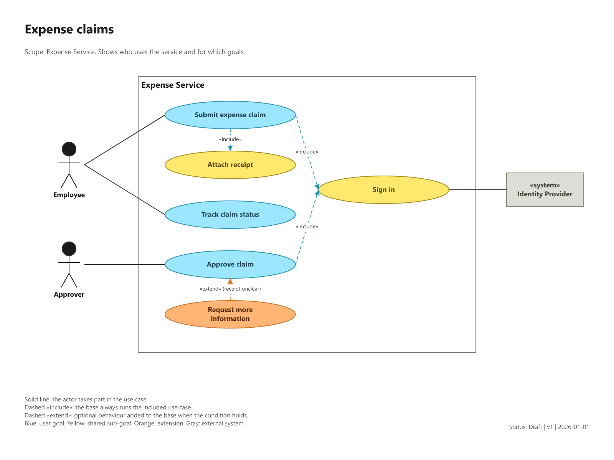

# miro-atlassian-skills

<p align="center">
  
</p>

Draw a use case, sequence, or data-flow diagram on Miro, then put the picture on a Confluence page. Five [Agent Skills](https://agentskills.io) share one index of your pages and frames, so the agent opens them by id.

Works with Cursor, Claude Code, Claude.ai, and any other agent the [skills CLI](https://skills.sh) installs.



## Install

Node.js 20 or newer. The command installs all five skills and asks which agents to use.

```bash
npx skills add HuzaifaTanzeel/miro-atlassian-skills
```

Add `-g` to install for every project. Later, update with the same flag you installed with:

```bash
npx skills update -y
```

## Claude.ai

Claude.ai has no `npx`. Download one zip per skill from the [Claude skill zips](https://github.com/HuzaifaTanzeel/miro-atlassian-skills/releases/latest) release and upload it. Each zip contains `<skill-name>/SKILL.md`.

| Skill | Download |
|---|---|
| Workspace map | [workspace-map.zip](https://github.com/HuzaifaTanzeel/miro-atlassian-skills/releases/latest/download/workspace-map.zip) |
| Use case diagram | [miro-use-case-diagram.zip](https://github.com/HuzaifaTanzeel/miro-atlassian-skills/releases/latest/download/miro-use-case-diagram.zip) |
| Sequence diagram | [miro-sequence-diagram.zip](https://github.com/HuzaifaTanzeel/miro-atlassian-skills/releases/latest/download/miro-sequence-diagram.zip) |
| Data flow diagram | [miro-data-flow-diagram.zip](https://github.com/HuzaifaTanzeel/miro-atlassian-skills/releases/latest/download/miro-data-flow-diagram.zip) |
| Publish to Confluence | [miro-to-confluence.zip](https://github.com/HuzaifaTanzeel/miro-atlassian-skills/releases/latest/download/miro-to-confluence.zip) |

Customize → Skills → **+** → **Create skill** → **Upload a skill**. Turn on **Code execution and file creation** under Settings → Capabilities first. On Team and Enterprise, an owner enables that under Organization settings → Plugins & skills. When a newer release is published, upload the zip again.

## Connect Miro and Atlassian

Sign in in the browser. Keep tokens out of files and chats.

| Connector | URL |
|---|---|
| Miro | `https://mcp.miro.com/` |
| Atlassian | `https://mcp.atlassian.com/v2/mcp` |

**Cursor.** Install both marketplace plugins, or save this as `.cursor/mcp.json`:

```json
{
  "mcpServers": {
    "miro": { "url": "https://mcp.miro.com/" },
    "atlassian": { "url": "https://mcp.atlassian.com/v2/mcp" }
  }
}
```

**Claude Code.** Then run `/mcp` and sign in to each.

```bash
claude mcp add --transport http miro https://mcp.miro.com/
claude mcp add --transport http atlassian https://mcp.atlassian.com/v2/mcp
```

**Claude.ai.** Settings → Connectors. Add both URLs and sign in.

## Set up the workspace

New chat, both connectors signed in. Paste this once. The agent creates the config and the map. On Claude.ai, paste the "Workspace map: …" line it returns into the project instructions.

```text
Set up miro-atlassian-skills for this workspace. I have signed in to the Miro and Atlassian connectors. I do not have miro-atlassian.config.yaml or a workspace map yet. Do not ask me to write YAML or markdown by hand.

1. From Atlassian, list the sites I can access. If there is more than one, ask which. Then list Confluence spaces on that site (key, name, id).
2. From Miro, list my boards (name and URL).
3. Ask me once, with numbered choices:
   - which Confluence space
   - which Miro board (or all my boards)
   - where to create a page titled "Workspace map" (suggest a standards or engineering parent if one exists, otherwise the space home)
4. After I answer: scan that space's page tree (titles and ids only, no page bodies) and the chosen board's frames. Build the map from that.
5. Ask before creating the page, then create "Workspace map" where I said, and put the map in it.
6. If this environment can write files, also write miro-atlassian.config.yaml in the project root, .miro-atlassian/workspace-map.md, and add .miro-atlassian/ to .gitignore. If there is no project folder (Claude.ai), skip local files and give me one line to paste into Project instructions: "Workspace map: Confluence page <id> <url>. Read it before searching Confluence or Miro."
7. Report counts (pages, folders, templates, boards, frames) and any diagram-target rows I should fill. Then stop. Do not draw a diagram until I ask.
```

## What to say next

```text
Draw a use case diagram for a customer uploading evidence and a reviewer accepting it.
Draw a sequence diagram for closing a remediation issue after a retest.
Draw a context data flow diagram for that same evidence upload, and mark the trust boundary.
Publish the sequence diagram to the Sequence Diagrams page.
```

| Skill | Use it when you want |
|---|---|
| [`workspace-map`](skills/workspace-map/SKILL.md) | The index built, refreshed, or a page or frame found by name. |
| [`miro-use-case-diagram`](skills/miro-use-case-diagram/SKILL.md) | Who uses the system, and for which goals. |
| [`miro-sequence-diagram`](skills/miro-sequence-diagram/SKILL.md) | One scenario in order: lifelines, messages, fragments. |
| [`miro-data-flow-diagram`](skills/miro-data-flow-diagram/SKILL.md) | Where data comes from, what changes it, where it is kept. |
| [`miro-to-confluence`](skills/miro-to-confluence/SKILL.md) | That frame on a Confluence page as a PNG plus a short description. |

Cursor and Claude Code upload the PNG as a page attachment. On the Claude free plan the shell cannot reach Confluence, so the PNG is placed inline in the page instead.

## License

[MIT](LICENSE). Sources: [CREDITS.md](CREDITS.md). Contributors: [CONTRIBUTING.md](CONTRIBUTING.md).
