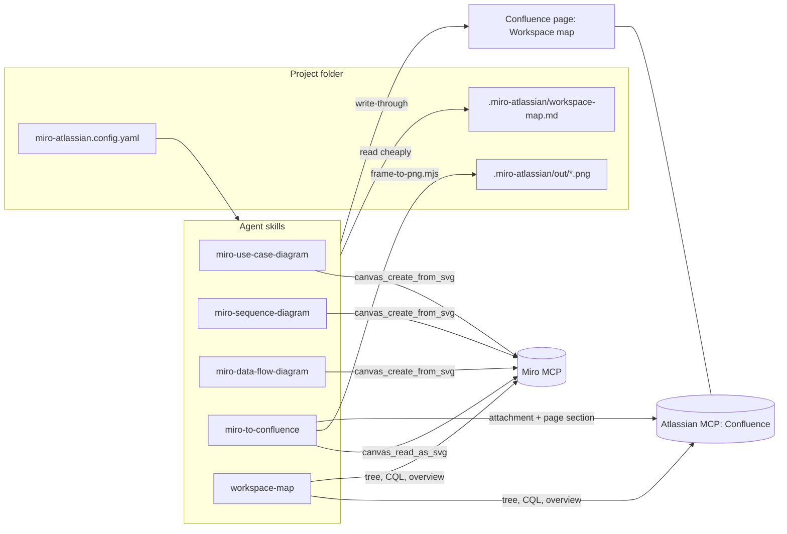

# Architecture

## Pieces

- **Diagram skills** draw one notation each on a Miro frame. They share `miro-board-conventions.md` (frame naming, placement, regions, palette, check loop).
- **`miro-to-confluence`** reads a frame, renders a PNG locally, uploads it, and writes a described section on a page.
- **`workspace-map`** builds and repairs the map. Every skill reads it and writes its own rows back.
- **Shared files** live in `shared/` and are copied into each skill's `references/` by `scripts/sync-shared.mjs`, because skills are installed one by one and cannot reach outside their folder.

## Why a map

Without it, an agent asked to "put this on the sequence diagrams page" searches, lists children, opens candidate pages, and reads bodies until it finds the place. With the map it reads a small cached file, checks one version number, and calls the page by id.

| Lookup | Without map | With map |
|---|---|---|
| Find target page | 2 to 6 calls, several page bodies | 0 calls (cache) or 1 summary call |
| Find a frame | Board overview or search | 0 calls |
| Keep it current | n/a | 1 page update per task (write-through) |

The map lives on a Confluence page so the whole team's agents share it, with a local cache so reads cost almost nothing. Changes made by the skills are written through at the end of each task. Changes made by people are picked up by a delta resync (CQL `lastmodified`, Miro frame-id diff) when the map is stale or an id is missing.

## Rendering

`miro-to-confluence/scripts/frame-to-png.mjs` converts the SVG that `canvas_read_as_svg` returns into standalone SVG, then PNG, with `@resvg/resvg-js` (prebuilt binaries, no system libraries). Connectors are routed from their recorded sides. Mermaid diagram widgets are rendered with `@mermaid-js/mermaid-cli` through npx. The PNG is close to, not identical with, Miro's own rendering; layouts in the diagram skills use only shapes the converter draws.

## Plugging in Jira later

Jira is out of scope today, and the map has no Jira catalog on purpose: issue data changes too often to cache, and a copy would go stale.

The plug-in points already in place:

1. **`links` column.** Map rows may carry issue keys (`PROJ-12`) as pointers. Today they are only carried along.
2. **Config.** `jira.projectKey` is reserved in `miro-atlassian.config.yaml`.
3. **Tool map.** `shared/tool-map.md` lists the Jira tools as reserved.
4. **Tool budget.** Jira tools are listed as safe to disable, and are re-enabled when a Jira skill is installed.

A future `jira-*` skill would:

- Read keys from `links` to go from a diagram or page to its tickets, and fetch issues live with `getJiraIssue` or one JQL query (`key in (...)`).
- Add keys to `links` when it creates or links an issue (one write-through, same procedure).
- Never add issue rows to the map.

No change to the existing skills is needed. The diagram skills could later pass "use cases from these tickets" to the Jira skill, but that is a feature of the new skill, not of this map.

## Adding another tool or server

- **Another diagram notation**: a new `skills/miro-<notation>-diagram/` with its own `notation.md`, `layout.md`, `checklist.md`, and an entry in `scripts/sync-shared.mjs` for the shared files.
- **Another documentation target** (for example Notion or a Git wiki): a new publish skill that reuses `frame-to-png.mjs` (copy it) and the map contract. Add a table for that system to the map format in `shared/map-contract.md`.
- **Another MCP server for Confluence**: add its tool names to `shared/tool-map.md`.
